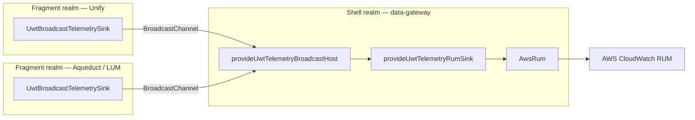

# Integrating `@absaoss-cps/ngx-ui-watchtower` into `data-gateway`

**Audience:** the AI coding agent (GitHub Copilot) doing the integration.

**This document is self-contained.** Every code sample you need is inlined
here — you are not expected to have access to any other repository. Passages
quoted from the library's own `DESIGN.md` and `README.md` are quoted in full
where they matter; if those two files were copied into `data-gateway`
alongside the library source, they are worth reading, but nothing here depends
on it.

Everything below was verified against the library source, not recalled from
memory. Where a rule has a "why", the why is included — you will need it to
make judgement calls this document does not anticipate.

---

## 0. Mission

`data-gateway` is an **Angular application with SSR** that acts as a **shell**
composing embedded **fragments** (Unify, Aqueduct, LUM). It currently has its
own `RumService` and a server-side credential broker at
`src/rum/broker.server.ts`.

Your job:

1. Land `@absaoss-cps/ngx-ui-watchtower` in the repo so it builds, type-checks and tests.
2. Wire the shell: telemetry providers, the RUM sink, the broadcast host.
3. Reuse the existing broker for credentials.
4. **Retire `RumService` without changing a single event on the wire.**
5. Declare the app's scenario and step vocabulary.
6. Propose and implement scenarios and BI events for the app's real use cases.

**Scope note:** `data-gateway` has no log backend, so this integration covers
**scenario telemetry and BI events only**. Logging is deliberately out of
scope — see §3.2.

### Four non-negotiables

| #   | Constraint                         | What it means in practice                                                                                                                                       |
| --- | ---------------------------------- | --------------------------------------------------------------------------------------------------------------------------------------------------------------- |
| 1   | **npm-swap-ready**                 | The library is temporarily vendored as a source tree. Removing it later must be a config-only change. See §2 "The npm-swap contract".                           |
| 2   | **Wire parity with `RumService`**  | Every event `RumService` sends today must still arrive at CloudWatch RUM with the same event type and equivalent payload. Migrate first, delete second. See §5. |
| 3   | **SSR-safe**                       | `data-gateway` server-renders. The library is already SSR-safe — do not add redundant guards, and do not break the existing ones. See §1.3.                     |
| 4   | **Shell hosts, fragments forward** | Exactly one realm owns the AWS client. The shell. Fragments broadcast to it. See §1.                                                                            |

---

## 1. Architecture

### 1.1 Why the shell must host

A composed page runs the shell and each fragment in **its own JavaScript
realm**. [Web Fragments](https://web-fragments.dev) — the model this library
was explicitly designed against (`DESIGN.md` §13) — "utilizes a hidden iframe
to create a clean JavaScript context"; the iframe is never rendered, its DOM
is reprojected into a Shadow Root in the host document, and its
`window.location` is kept in sync with the host's.

A separate realm means a separate Angular injector, which means **every realm
would build its own copy of every telemetry service — including its own AWS
RUM client.** Left alone:

| Left alone                    | Consequence                                                                                                    |
| ----------------------------- | -------------------------------------------------------------------------------------------------------------- |
| N RUM clients                 | Each mints its own session. One human becomes N sessions and N users; unique-user counts are wrong             |
| N × `sessionEventLimit`       | Separate event budgets, separate dispatches, N calls to the credentials broker, N copies of the SDK downloaded |
| Shared origin, shared cookies | N clients contend for one RUM session cookie                                                                   |

The arrangement: **one realm hosts; the rest forward.**



One session, one budget, one bundle. Application code inside a fragment does
not change — it injects the same services and calls the same methods; only
the sink binding differs.

### 1.2 The fragments do not broadcast yet — that is fine

The fragment teams have not implemented their side. **This is a supported,
documented state, not a defect.** From `README.md`: _"A fragment with no shell
still works"_ — and symmetrically, a host with no fragments simply receives
nothing. `UwtTelemetryBroadcastHost` opens its channel, wins the leader
election, announces identity, and sits idle.

**Therefore: provide the broadcast host now.** Do not defer it, do not
feature-flag it, do not write a "we'll add this later" TODO. When the
fragments start broadcasting, the shell must already be listening — the host
is constructed eagerly via `provideAppInitializer` precisely so that it is
listening before any fragment sends.

Hand §8 to the fragment teams as their contract.

### 1.3 SSR is already handled — do not re-solve it

The library guards itself. Confirmed in source:

- `UwtRumTelemetrySink` holds `private readonly isBrowser = uwtIsBrowser();`
  and returns early from both `init()` and every `record()` path when false.
- `uwtConnectBroadcastChannel` checks `uwtIsBrowser()` **and** feature-detects
  `globalThis.BroadcastChannel`, returning `undefined` on the server; every
  post/close is wrapped in `uwtSafeVoid`.
- `uwtIsBrowser()` is `isPlatformBrowser(inject(PLATFORM_ID))`.

`README.md` states it as a guarantee: _"SSR-safe — every browser-touching path
is a no-op on the server."_

**What this means for you:** register the providers unconditionally in the
shared app config. Do **not** split providers between browser and server
configs, and do **not** wrap `provideUwtTelemetryRumSink()` in a platform
check.

**What you still own:** any code _you_ write that touches `window`,
`navigator`, `localStorage` or `document` — including the value you pass as
`environment`. Guard those:

```ts
private readonly isBrowser = isPlatformBrowser(inject(PLATFORM_ID));

scenario.setData(this.isBrowser ? { language: navigator.language } : {});
```

```ts
// resolving `environment` runs during provider setup, on the server too
export function resolveDeploymentEnvironment(): 'development' | 'production' {
  const hostname =
    typeof window !== 'undefined' ? window.location.hostname : undefined;
  return hostname === 'localhost' ? 'development' : 'production';
}
```

> ⚠️ `uwtIsBrowser()` calls `inject(PLATFORM_ID)`, so it must run in an
> injection context — as a field initializer or in a constructor. The same
> applies to `uwtConnectBroadcastChannel`. This only matters if you write a
> custom sink.

---

## 2. Phase 0 — land the package

The library is vendored as a **library source tree** with two entry points.
`@absaoss-cps/ngx-ui-watchtower/rum` is a real ng-packagr **secondary entry
point**, not a folder convention.

### 2.1 Why `/rum` is a separate entry point

From `DESIGN.md` §3 — this is load-bearing, not cosmetic:

> A bundler resolves every static import in a module graph, and a dynamic
> `import()`'s specifier, whether or not that code path ever runs. Keeping the
> RUM sink and its `await import('aws-rum-web')` out of the main entry is what
> lets an app using only `'broadcast'`/`'noop'` build without `aws-rum-web`
> installed.

Consequences you must respect:

- RUM symbols (`provideUwtTelemetryRumSink`, `UWT_RUM_CREDENTIALS_PROVIDER`,
  `UwtRumBootstrap`, `UwtRumCredentials`, `UwtRumCredentialsProvider`,
  `UwtRumAppMonitorConfig`, `UwtRumTelemetrySink`) come from
  **`@absaoss-cps/ngx-ui-watchtower/rum`**. That is the entire `/rum` surface — seven exported
  names. Everything else comes from `@absaoss-cps/ngx-ui-watchtower`.
- **Never re-export the RUM sink from a shared barrel file.** That drags
  `aws-rum-web` into every consumer's module graph and undoes the split.
- `@absaoss-cps/ngx-ui-watchtower/rum` carries its own private copies of the internal utils
  (`uwtSafe`, `uwtIsBrowser`, …) because ng-packagr fixes each entry point's
  `rootDir` to its own `src`. Do not "de-duplicate" them.

### 2.2 TypeScript paths

Each entry point needs an entry. Point them at the vendored source:

```jsonc
// tsconfig.json
{
  "compilerOptions": {
    "resolveJsonModule": true, // only if you import version from a package.json
    "paths": {
      "@absaoss-cps/ngx-ui-watchtower": [
        "./ngx-ui-watchtower/src/public-api.ts"
      ],
      "@absaoss-cps/ngx-ui-watchtower/rum": [
        "./ngx-ui-watchtower/rum/src/public-api.ts"
      ]
    }
  }
}
```

Adjust the prefix to wherever the folder actually landed.

### 2.3 Jest module mapping — anchor the regexes

```js
// jest.config.js
moduleNameMapper: {
  '^@absaoss-cps/ngx-ui-watchtower$': '<rootDir>/ngx-ui-watchtower/src/public-api.ts',
  '^@absaoss-cps/ngx-ui-watchtower/rum$': '<rootDir>/ngx-ui-watchtower/rum/src/public-api.ts'
}
```

> ⚠️ **Anchor both patterns.** An unanchored `'@absaoss-cps/ngx-ui-watchtower'` also matches
> `@absaoss-cps/ngx-ui-watchtower/rum` and swallows the sub-path, so `/rum` imports resolve to
> the main barrel and every RUM symbol comes back `undefined` at test time.

### 2.4 Angular build config

```jsonc
// angular.json — the application's build options
"allowedCommonJsDependencies": ["shimmer"]
```

`shimmer` is a transitive CommonJS dependency of `aws-rum-web`. Without this,
the build emits a CommonJS warning per build.

### 2.5 TypeScript project wiring

The secondary entry point needs its own `tsconfig.lib.json` and
`tsconfig.spec.json`, plus `references` entries in the root tsconfig —
"without them nothing covered the `rum/` directory as a TypeScript project".

Two traps we actually hit in this workspace, both likely to recur:

- **`skipLibCheck: true`** is required in the app's `tsconfig.app.json`
  _and_ in the plain `tsconfig.json` (the one the VS Code language service
  resolves first). `aws-rum-web` bundles `rrweb` typings that do not compile
  under strict settings.
- **`rootDir`** must be set explicitly to span the workspace when the app
  imports library _source_ through `paths` rather than a built package.

> ⚠️ `tsc --noEmit` is a **no-op** against a solution-style root config
> (`"files": []` + `"references"`). It only checks the config's own
> `files`/`include`, not its references. Use **`tsc --build`** if you want a
> real type check. Also note `ts-jest` commonly runs with `diagnostics:
false`, so tests will not catch type regressions either.

### 2.6 Peer dependencies

```jsonc
"peerDependencies": {
  "@angular/common": "^22.1.3",
  "@angular/core": "^22.1.3",
  "aws-rum-web": "^3.2.1",
  "rxjs": "^7.8.2"
},
"peerDependenciesMeta": { "aws-rum-web": { "optional": true } }
```

`data-gateway` uses the RUM sink, so `aws-rum-web` must be a real dependency
of the app. The library's only true runtime dependency is `tslib`.

### 2.7 The npm-swap contract

This is the constraint that makes the future migration free. **Treat it as a
hard rule and enforce it in review:**

✅ **Allowed** — bare specifiers only:

```ts
import {
  provideUwtTelemetry,
  UwtScenarioTelemetryService
} from '@absaoss-cps/ngx-ui-watchtower';
import { provideUwtTelemetryRumSink } from '@absaoss-cps/ngx-ui-watchtower/rum';
```

❌ **Forbidden** — every one of these pins you to the vendored copy:

```ts
import { UwtScenarioTelemetryService } from '../../ngx-ui-watchtower/src/public-api'; // relative
import { UwtScenario } from '@absaoss-cps/ngx-ui-watchtower/src/lib/scenario/uwt-scenario/uwt-scenario'; // deep
import { UwtRumTelemetrySink } from './shared/telemetry-barrel'; // re-export
```

When the package is published, migration is:

1. Delete the vendored `ngx-ui-watchtower/` folder.
2. `npm install @absaoss-cps/ngx-ui-watchtower aws-rum-web`.
3. Delete the two `paths` entries and the two jest `moduleNameMapper` entries.
4. Delete the `references` entries for the vendored tsconfigs.

**Zero import statements change.** If a single import needs editing during this
migration, the contract was broken somewhere — find it.

---

## 3. Phase 1 — wire the shell

### 3.1 The wiring

This is the proven shape, taken from a working integration. Adapt it to
`data-gateway`'s bootstrap style — `makeEnvironmentProviders` works in both a
standalone `ApplicationConfig` and an NgModule `providers` array:

```ts
import {
  UWT_LOG_API_PROVIDER,
  UwtNoopLogApiProvider,
  provideUwtTelemetry,
  provideUwtTelemetryBroadcastHost
} from '@absaoss-cps/ngx-ui-watchtower';
import {
  UWT_RUM_CREDENTIALS_PROVIDER,
  provideUwtTelemetryRumSink
} from '@absaoss-cps/ngx-ui-watchtower/rum';
import './services/telemetry.schema'; // side-effect import — see §6

// One channel per browser tab — see §3.5. Browser-only: this module is
// evaluated during server rendering too, and nothing there needs an id.
const channelId =
  typeof window === 'undefined'
    ? undefined
    : `ngx-ui-watchtower-${crypto.randomUUID()}`;

if (channelId) {
  window.__uwtTelemetryChannel = channelId;
}

providers: [
  provideUwtTelemetry({
    application: 'data-gateway',
    environment: resolveDeploymentEnvironment(),
    version: packageJson.version
  }),
  provideUwtTelemetryRumSink(),
  provideUwtTelemetryBroadcastHost(channelId), // shell only
  // No log backend: say so explicitly. The broadcast host requires a log
  // provider (§3.2) and fails at bootstrap without one.
  { provide: UWT_LOG_API_PROVIDER, useClass: UwtNoopLogApiProvider },
  {
    provide: UWT_RUM_CREDENTIALS_PROVIDER,
    useExisting: DataGatewayRumCredentialsProvider
  }
];
```

### 3.2 Scenarios and BI only — no logging

`data-gateway` has **no log backend**, so it integrates **scenario telemetry
and BI events only**. Do not wire logging.

Concretely:

- **Do** bind `UWT_LOG_API_PROVIDER` to `UwtNoopLogApiProvider` (§3.1).
- **Do not** inject `UwtLoggerService` anywhere.
- **Do not** pass `withLogging(...)`.

Why the no-op provider is required even with no logging: the shell hosts the
broadcast channel, and fragments in `'broadcast'` mode forward their log lines
to it, for the shell's log provider to ship. `UwtTelemetryBroadcastHost`
therefore injects `UWT_LOG_API_PROVIDER` and fails at bootstrap (`NG0201`)
without one — a shell that silently dropped its fragments' logs would look
wired up while losing them. `UwtNoopLogApiProvider` is the explicit "no log
backend": records are discarded and `query()` finds none. Apart from the host,
only `UwtLoggerService` injects the token; `UwtScenarioTelemetryService` and
`UwtBITelemetryService` don't.

**What you give up:** the `correlationId` join between a log line and a
scenario. Everything a log call would have carried has to go somewhere else:

| Instead of                            | Do this                                                                         |
| ------------------------------------- | ------------------------------------------------------------------------------- |
| `logger.error('X failed', { error })` | `scenario.fail({ error })` — the normalized error ships on the scenario record  |
| `logger.warn` about a degraded path   | `scenario.incomplete({ reason })`, or a BI event if there is no scenario        |
| Free-text diagnostic context          | `scenario.setData({ … })` or step metadata — flat primitives, capped at 50 keys |
| A code-level trace                    | `console` behind the `debugScenario` flag; it is not shipped anywhere           |

If a log backend appears later, adding logging is additive: implement
`UwtLogApiProvider`, bind it to `UWT_LOG_API_PROVIDER` in place of the no-op
one, start injecting `UwtLoggerService`. Nothing already written has to
change, and fragments' log lines start arriving too.

### 3.3 `provideUwtTelemetry` provides no destination — by design

> ⚠️ **This is the single most common first-run failure.**
> `provideUwtTelemetry` registers _configuration only_. A sink must be bound
> separately; injecting a telemetry service without one fails at bootstrap
> with **`NG0201`**.

From `DESIGN.md` §10, on why there is no default:

> Defaulting to a no-op sink and an in-memory log store would let an
> application forget to wire a destination and still run perfectly while
> shipping nothing — invisible until somebody asks why the dashboard is empty.
> A missing provider is a configuration error caught on the first run.

For `data-gateway` the sink is `provideUwtTelemetryRumSink()`. Scenario and BI
services both require it.

### 3.4 What `provideUwtTelemetry` actually registers

```ts
provideUwtTelemetry(identity, ...features);
```

Registers `UWT_TELEMETRY_IDENTITY`, then the defaults for `UWT_LOG_CONFIG`,
`UWT_SCENARIO_TELEMETRY_CONFIG`, `UWT_BI_TELEMETRY_CONFIG`, `UWT_REDACT_CONFIG`, then any features
you pass (later-wins DI). Identity:

```ts
interface UwtTelemetryIdentity {
  application: string; // 'data-gateway' — becomes a session attribute
  environment: string; // 'dev' | 'qa' | 'prod'
  version: string;
  eventNamespace?: string; // default 'com.uwt' → com.uwt.scenario / .scenario.step / .bi
}
```

Optional features, all omittable, each replacing exactly one config token.
`data-gateway` should need none of them at first:

| Feature                                                                                                          | Defaults                                                      | Use in data-gateway             |
| ---------------------------------------------------------------------------------------------------------------- | ------------------------------------------------------------- | ------------------------------- |
| `withScenarios({ defaultTimeoutMs, emitLifecycleEvents, maxSteps, userTimings, markCleanupFallbackMs, redact })` | `30_000`, `false`, `50`, `false`, `300_000`, `true`           | Only with a specific reason     |
| `withBIEvents({ dedupWindowMs, dedupMaxKeys, redact })`                                                          | `400`, `100`, `true`                                          | Only with a specific reason     |
| `withRedaction({ … })`                                                                                           | see §10.4                                                     | If URLs can carry personal data |
| `withLogging({ … })`                                                                                             | `minLevel: 'log'`, `mirrorErrorsToRum: false`, `redact: true` | **No** — see §3.2               |

**Start with defaults.** Only add a feature when you have a specific reason,
and record the reason in a comment.

### 3.5 One broadcast channel per browser tab — required

**Give every tab its own channel name.** Do not rely on the shared default.

`BroadcastChannel` and the Web Locks leader election that arbitrates between
hosts are both **origin-wide, not per-tab**. With the default channel, if a
user has `data-gateway` open in two tabs:

- Only one tab's host wins the election and records — so a single event is
  never recorded twice. That part is fine.
- But the **losing tab's fragments keep forwarding on the same origin-wide
  channel**, so their events are recorded through the _winning_ tab's AWS RUM
  client — attributed to a different tab's session and page than the one they
  actually came from.

`UwtBroadcastMessage` carries no tab or window identifier at all, so the
protocol cannot route a message back to its originating tab even in principle.
A per-tab channel name is the only fix.

#### Getting the id to the fragments

Web Fragments has **no built-in way for the shell to hand a runtime value to a
fragment**, so this needs a convention. Use a global on the top-level window.
It is reachable because the framework requires every fragment to share the
shell's origin — the same requirement that makes `BroadcastChannel` work at
all.

```ts
// shell — at module scope, so it is set before any fragment can read it
declare global {
  interface Window {
    __uwtTelemetryChannel?: string;
  }
}

// Browser-only. This module is evaluated during server rendering too,
// where there is no `window` — and, on Node below 19, no global `crypto`
// either. Nothing is lost: the broadcast host no-ops on the server, and the
// browser mints its own id when it boots.
const channelId =
  typeof window === 'undefined'
    ? undefined
    : `ngx-ui-watchtower-${crypto.randomUUID()}`;

if (channelId) {
  window.__uwtTelemetryChannel = channelId;
}

// …then pass the same value to the host. `undefined` on the server is fine:
// the provider simply omits the channel override.
provideUwtTelemetryBroadcastHost(channelId);
```

Fragments read it back off `window.top` (§8 has their side, ready to hand
over).

> ⚠️ **Do not try to pass it on the fragment's URL.** The obvious approach —
> a `?channel=` query parameter — does not work here, and it is worth knowing
> why so nobody "fixes" this back later:
>
> - The shell never sets a fragment's URL. A fragment is embedded as
>   `<web-fragment fragment-id="unify">`, and a server-side `FragmentGateway`
>   maps that id to an endpoint and proxies it through the shell's origin.
> - By default a fragment is **bound**: it "shares (binds) `window.location`
>   and navigation history with the existing application", initialised to the
>   top-level app's location. So a fragment reading
>   `window.location.search` sees the **host's** query string, not one of its
>   own.
>
> Only an **unbound** fragment (one given an explicit `src` attribute) has its
> own location — but going unbound decouples that fragment from the shell's
> routing, which is far too large a change to make in order to pass a
> telemetry id.

> ⚠️ Generate the id **once per page load**, at shell bootstrap, before any
> fragment is composed. Generating it per fragment, or regenerating it on
> navigation, puts fragments on channels no host is listening to — and because
> the broadcast sink fails open, that failure is **completely silent**.

#### Duplicated tabs are covered — and why it had to be a global

Duplicating a tab loads a fresh document, so the module-scope code above runs
again and `window.__uwtTelemetryChannel` gets a **new** id. The duplicate is
therefore on its own channel, hosted by its own tab, exactly like any other
independently opened tab.

That is the reason this is a `window` global rather than `sessionStorage`.
Chrome **copies `sessionStorage` into a duplicated tab**, so a
sessionStorage-based id would arrive pre-populated in the duplicate, both tabs
would share a channel, and the cross-attribution this whole section exists to
prevent would come straight back — in the one case people hit by accident.

> **This buys correct attribution, not a separate RUM session.** A per-tab
> channel guarantees a tab's fragments are recorded through _that tab's_ RUM
> client, carrying that tab's page context. It does **not** give each tab its
> own `sessionId`: the RUM session lives in a cookie (`allowCookies` defaults
> to `true`, 30-minute length), and cookies are shared across every tab on the
> origin. Two tabs of `data-gateway` are one RUM session by design — RUM
> models a session as a _user's_ session, not a tab's, and it deliberately
> survives reloads and navigations.
>
> Forcing a distinct session per tab would mean `allowCookies: false`, which
> also makes **every reload** a new session and inflates session counts. Do
> not reach for it to solve a tab problem; use `pageId` (or a `tabId` you mint
> yourself and put in scenario metadata) if you need to tell tabs apart in
> queries.

---

## 4. Phase 2 — credentials from the existing broker

`data-gateway` already has `src/rum/broker.server.ts`. Do not replace it —
adapt to it. The library deliberately knows nothing about AWS account details:

```ts
export interface UwtRumCredentialsProvider {
  /**
   * Called once at startup and again shortly before each credential expiry.
   * Returning `null` disables RUM for the session — the telemetry layer stays
   * fully functional, it simply stops shipping.
   */
  load(): Promise<UwtRumBootstrap | null>;
}

export interface UwtRumBootstrap {
  config: UwtRumAppMonitorConfig; // applicationId, region, applicationVersion required
  credentials?: UwtRumCredentials; // accessKeyId, secretAccessKey, sessionToken, expiration
}
```

### 4.1 Reference implementation

```ts
@Injectable({ providedIn: 'root' })
export class DataGatewayRumCredentialsProvider implements UwtRumCredentialsProvider {
  async load(): Promise<UwtRumBootstrap | null> {
    let response: Response;
    try {
      response = await fetch('/rum/init', {
        headers: { Accept: 'application/json' },
        cache: 'no-store' // this response carries live, temporary AWS credentials
      });
    } catch {
      // Network-level failure rejects before any response exists — treat it
      // the same as an unreachable broker, per load()'s documented contract.
      return null;
    }

    if (!response.ok) return null;

    const init = await response.json();

    // Credentials are required: without them the client would start and then
    // fail every dispatch silently.
    if (!init?.enabled || !init.config || !init.credentials) return null;

    return { config: init.config, credentials: init.credentials };
  }
}
```

Import the types with `import type`, as above, so this file carries no
runtime dependency on `@absaoss-cps/ngx-ui-watchtower/rum` at all.

### 4.2 The three-state contract

| Return                             | Meaning                                                                                                                                                                                                                                                                                                                          |
| ---------------------------------- | -------------------------------------------------------------------------------------------------------------------------------------------------------------------------------------------------------------------------------------------------------------------------------------------------------------------------------- |
| `null`                             | Disable RUM for this session. Works **mid-session** too — a later refresh returning `null` tears the running client down (calling the SDK's own `disable()`, so listeners/plugins/dispatch timer actually stop) and stops scheduling.                                                                                            |
| `{ config, credentials }`          | Normal path.                                                                                                                                                                                                                                                                                                                     |
| `{ config }` with no `credentials` | Valid **only** for an app monitor configured for unauthenticated access, and only if the session was never authenticated. On a _later_ refresh for an already-authenticated session, the sink keeps the existing credentials and retries, with a dev-mode warning — the AWS client has no way to clear credentials once applied. |

### 4.3 Refresh behaviour you get for free

- Refresh is scheduled **5 minutes before** `expiration`.
- The delay is clamped to `MAX_TIMEOUT_MS` (2 147 483 647 ms — the 32-bit
  signed limit `setTimeout` silently overflows past).
- An already-expired or unparsable `expiration` does **not** fire immediately;
  it falls back to a bounded 30 s retry, so a broker stuck returning bad
  credentials cannot tight-loop the sink.
- The app initializer `provideUwtTelemetryRumSink()` registers deliberately
  **does not await** the sink's `init()`, so a slow or hung broker never
  delays first paint. You do not need to write an initializer.

### 4.4 What is deliberately absent from the config

`UwtRumAppMonitorConfig` mirrors the SDK's `Config` **except**:

- `identityPoolId`, `guestRoleArn` — the SDK's Cognito guest-identity flow.
  Credentials come from your broker instead. **Do not try to add them back.**
- `endpointUrl` — always recomputed from `endpoint`.
- `sessionId`, `userId` — owned at runtime by the sink.

---

## 5. Phase 3 — retire `RumService` without changing the wire

**This is the highest-risk part of the migration.** `@absaoss-cps/ngx-ui-watchtower` emits its
own event types (`com.uwt.scenario`, `com.uwt.scenario.step`, `com.uwt.bi`)
with its own payload envelopes. A naive "delete `RumService`, call
`biTelemetry.track()` instead" **will silently change what CloudWatch
receives** and break every existing dashboard, extended metric and Logs
Insights query.

From `DESIGN.md` §6:

> It is configurable because **event types are a contract with whatever
> already queries them** — extended metrics, Logs Insights queries,
> dashboards.

### 5.1 Procedure — do these in order

**Step 1 — Inventory.** Before changing anything, find every call site and
record what goes on the wire today:

```bash
rg -n "recordEvent|recordError|recordPageView|dispatch|pinUserId|addSessionAttributes" src/
```

Build a table. Do not skip the payload column — the event type alone is not
parity:

| Call site             | AWS API       | Event type       | Payload keys        | Notes                 |
| --------------------- | ------------- | ---------------- | ------------------- | --------------------- |
| `RumService.trackX()` | `recordEvent` | `dg.user.action` | `{action, page, …}` | used by dashboard "…" |
| …                     |               |                  |                     |                       |

**Step 2 — Decide the parity tool per row.** Three options, in order of
preference:

| Tool                                                      | Use when                                                             | What you get                                                                                                                                                                                                                                 |
| --------------------------------------------------------- | -------------------------------------------------------------------- | -------------------------------------------------------------------------------------------------------------------------------------------------------------------------------------------------------------------------------------------- |
| **`eventNamespace`**                                      | The existing types differ from `com.uwt.*` only by prefix            | Set `eventNamespace: 'dg'` once and all three library types become `dg.scenario`, `dg.scenario.step`, `dg.bi`. Cheapest option.                                                                                                              |
| **`track(name, metadata, { eventType })`**                | An existing dashboard or metric filter needs a _specific_ event type | The event type is exactly yours; the **payload becomes the `UwtBIEvent` envelope** (`eventName`, `eventTime`, `metadata`, `application`, `scenarioId?`, `feature?`). Documented as _"a migration escape hatch, not a pattern to reach for."_ |
| **`inject(UwtTelemetrySink).record(eventType, payload)`** | You need byte-exact payload parity                                   | Raw passthrough. You own the payload shape entirely. Use sparingly and comment why.                                                                                                                                                          |

**Step 3 — Migrate, keeping both paths alive.** Do not delete `RumService`
yet. Migrate call sites one at a time.

**Step 4 — Diff the wire.** Verify before deleting. Turn on the debug flags
and compare old vs new output:

```js
localStorage.setItem('debugScenario', 'true');
localStorage.setItem('debugBI', 'true');
```

Every debug line's **second console argument is the literal object handed to
the sink** — so console capture is full-fidelity, not a summary. Compare
against the inventory table from Step 1.

**Step 5 — Delete `RumService`** only once every row in the table is ticked.

### 5.2 Page views — check this specifically

The RUM client **already records a page view on every navigation** via
`history.pushState`, which covers the Angular router automatically. The
library deliberately adds no page-view recorder of its own:

> There is deliberately no `provideUwtRouterPageViews()` … a second recorder
> on top of it would produce **two** page views per navigation, double the
> `interaction` counter, and leave the first page with a `timeOnParentPage` of
> roughly zero.

So:

- If `RumService` records page views **manually**, you must either drop that
  code (letting the SDK's automatic page views stand) or keep it via
  `UwtRumTelemetrySink.recordPageView(pageId)` **and** set
  `disableAutoPageView: true` — never both recorders at once.
- If `data-gateway`'s routes carry identifiers, the automatic page id (with
  the default `pageIdFormat: 'PATH'`) is the **resolved** path — one page id
  per record id. That is a cardinality problem _and_ a PII problem. Derive the
  template yourself, call `recordPageView(template)`, and set
  `disableAutoPageView: true`.

> ⚠️ **Route-template trap:** a route declared with `matcher` has no `path` at
> all, so walking `routeConfig.path` reports every such route as `/`. Derive
> the template from the segments the match actually consumed, putting
> parameters back as `:name`.

### 5.3 Reserved metadata prefix

Keys under `aws:` are reserved by the RUM client — it drops them with a
console warning. The sink filters them out before recording. If `RumService`
sets any, they were already being dropped; do not port them.

### 5.4 User identity

`sink.setUserId(id)` / `setUserId(undefined)` — `setUserId('')` signs out
too. Pass an **opaque** id — never an email, username or account number.

> ⚠️ Signing out starts a **fresh session** with a new anonymous id
> (`pinUserId` has no inverse), which emits a `session_start` event and
> re-rolls sampling. If `RumService` does something different on sign-out,
> note the behaviour change explicitly.

---

## 6. Phase 4 — declare the vocabulary

Scenario, step and BI event names are **metric dimensions**. From
`DESIGN.md` §4:

> A typo here would not just produce a wrong number. It would silently start a
> **second, incomplete** metric series, and the alarm built on the first one
> would keep reading healthy. Interpolating an id — ``step(`load-${id}`)`` —
> does the same at a larger scale. The type turns both into compile errors.

Create `src/app/services/telemetry.schema.ts`:

```ts
/**
 * This application's telemetry vocabulary.
 *
 * Scenario, step and business event names are metric dimensions, declared
 * once here rather than as free text at each call site. Anything not listed
 * below is a compile error.
 */
declare module '@absaoss-cps/ngx-ui-watchtower' {
  interface UwtScenarioNames {
    /** A router navigation, from click to activated route. */
    'route-navigation': true;
    /** Mounting and activating an embedded fragment. */
    'fragment-load': true;
    // …
  }

  interface UwtScenarioSteps {
    'resolve-route': true;
    activate: true;
    // …
  }

  interface UwtBIEventNames {
    /** The user exported the current result set. */
    export_clicked: true;
    // …
  }
}

export {};
```

> There is a fourth augmentable registry, `UwtLoggerNames`. **Do not declare
> it** — `data-gateway` has no logging (§3.2). Add it only if a log backend
> appears later.

### 6.1 The side-effect import convention

A module augmentation applies **program-wide**, not per-file: once
`telemetry.schema.ts` is part of the compilation — which your `tsconfig`'s
`include` guarantees — every file is checked against the registries, whether or
not it imports the schema. So this import is a convention, not a compiler
requirement:

```ts
import '../../services/telemetry.schema';
```

Keep it anyway in the files that own the wiring — wherever you call
`provideUwtTelemetry`, and in your router-telemetry service — so the dependency
stays visible and the schema file cannot become unreferenced during a refactor.
Components that merely pass a declared name to a service of your own do not
need it; in the reference app,
`app.component.ts`, `theme-toggle.component.ts` and
`navigation-sidebar.component.ts` all pass declared BI names with no such
import and type-check clean.

### 6.2 What is and is not a closed vocabulary

| Closed (augmentable, compile-checked)                        | Open (plain `string`) |
| ------------------------------------------------------------ | --------------------- |
| `UwtScenarioNames` → `name`                                  | `feature`             |
| `UwtScenarioSteps` → `step()` **and** `aggregateStart/End()` | `operation`           |
| `UwtBIEventNames` → `track()`                                | BI `eventType`        |
| (`UwtLoggerNames` → `getLogger()` — not used here)           |                       |

Mechanism: `UwtRegistered<T>` resolves to `string` while the registry is
empty, then to `keyof T`. So adoption is incremental — names are unconstrained
until the first augmentation, then fully checked. Steps and aggregates share
one registry because they name the same kind of thing.

If you wrap `track()` in a service of your own, type its parameter
`UwtBIEventName`, not `string` — once `UwtBIEventNames` is augmented, a plain
`string` is no longer assignable and the wrapper stops compiling.

`'scenario-start'` and `'scenario-end'` are written by the library and need no
declaration. They bookend every settled scenario's `steps[]` and do not count
toward `stepCount` or `maxSteps`.

---

## 7. Phase 5 — propose scenarios and BI events

### 7.1 The two concerns, and when to use which

| Concern      | Answers                                                    | Emits                                |
| ------------ | ---------------------------------------------------------- | ------------------------------------ |
| **Scenario** | "Did this user journey succeed, and how long did it take?" | One RUM event at settlement          |
| **BI event** | "Did this meaningful thing happen?"                        | One RUM event, deduped within 400 ms |

A BI event that happens inside a journey should carry its `scenarioId`, so the
two join up:

```ts
biTelemetry.track('export_clicked', { format }, { scenarioId: scenario.id });
```

(The third concern, logging, is out of scope here — §3.2.)

### 7.2 How to find candidates

Read `data-gateway`'s source and look for:

- **Every await the user actually waits on** → a scenario. Fragment mount,
  route load, a data fetch that gates the screen, an upload, an export.
- **Every irreversible or meaningful click** → a BI event. Submit, export,
  switch fragment, change a filter that costs a round trip.
- **Every `catch` block** → `scenario.fail({ error })`. With no log backend,
  the scenario record is the _only_ place that error is reported, so make sure
  every catch that ends a journey settles it — a swallowed error that leaves
  the scenario running becomes a misleading `timeout` half a minute later.

### 7.3 Choose the right settle status — this is the whole point

Four unsuccessful outcomes exist because _"each demands a different response,
and collapsing them together would make the failure rate useless for
alerting"_:

| Status       | Method               | Meaning                                                                                              | Response                               |
| ------------ | -------------------- | ---------------------------------------------------------------------------------------------------- | -------------------------------------- |
| `success`    | `complete()`         | Journey reached its goal                                                                             | —                                      |
| `failure`    | `fail({ error })`    | A defect — the journey broke                                                                         | Investigate; alert if the rate spikes  |
| `abandoned`  | `cancel({ reason })` | Stopped being relevant: navigated away, superseded, page unloaded                                    | Engagement signal, **not** a defect    |
| `incomplete` | `incomplete()`       | An expected path that did not reach the goal — no results, a guard declined, a flag routed elsewhere | Product signal, not an engineering one |
| `timeout`    | _automatic_          | Never settled within its deadline                                                                    | Engagement signal, distinct from both  |

Getting this wrong is the most common way to make a telemetry dashboard
useless. A user navigating away mid-load is **not** a defect.

> Prefer the named methods over `settle(status, …)`. _"Naming the outcome at
> the call site is what lets someone find every place a journey can fail just
> by searching for `.fail(`."_ `settle()` exists for adapters mapping an
> external status.

Terminal states are absorbing: a `catch` that calls `fail()` followed by a
`finally` that calls `complete()` records the **failure**. That is deliberate.

### 7.4 Starter catalogue for a shell

Propose these to the user, then implement what they confirm. Adapt names to
`data-gateway`'s real vocabulary.

**Scenarios**

| Name                 | Steps                              | Settles                                                                                                                           |
| -------------------- | ---------------------------------- | --------------------------------------------------------------------------------------------------------------------------------- |
| `fragment-load`      | `request`, `mount`, `activate`     | `complete()` on first meaningful render; `cancel({reason:'superseded'})` if the user switches away; `fail({error})` on load error |
| `route-navigation`   | `resolve-route`, `activate`        | §7.5 has a complete implementation to adapt                                                                                       |
| `shell-boot`         | `bootstrap`, `auth`, `shell-ready` | `complete()` when the shell is interactive                                                                                        |
| `auth-token-refresh` | `request`                          | `complete()` / `fail()` / `incomplete()` when the user is simply logged out                                                       |
| `export-download`    | `request`, `transfer`              | `complete()` on save; `cancel({reason:'user-cancelled'})`                                                                         |

**BI events** — `snake_case`, low cardinality, never an id interpolated in:
`fragment_opened`, `export_clicked`, `filter_applied`, `search_submitted`
(debounced — see §10.1), `sign_out_clicked`. Every one you settle on goes into
`UwtBIEventNames` in the schema file from §6 — an undeclared name is a compile
error once that registry has its first entry.

Because there is no log stream to fall back on, put diagnostic detail on the
scenario itself: `feature`/`operation` for classification, `statusCode` for
error-category grouping, `reason` for a low-cardinality cause, and
`setData()`/step metadata for the rest.

### 7.5 Route navigation — a working implementation to adapt

Router navigation looks trivial and is not. Below is a complete, working
handler, already adapted for `data-gateway` (no logging). It came out of a
mutation-tested implementation, and three of the things in it are not obvious
— each was found the hard way. **Read the four notes after the code before
changing anything in it.**

```ts
import { DestroyRef, inject, Injectable } from '@angular/core';
import { takeUntilDestroyed } from '@angular/core/rxjs-interop';
import {
  Event as RouterEvent,
  NavigationCancel,
  NavigationCancellationCode,
  NavigationEnd,
  NavigationError,
  NavigationSkipped,
  NavigationSkippedCode,
  NavigationStart,
  Router
} from '@angular/router';
import {
  UwtScenario,
  UwtScenarioTelemetryService
} from '@absaoss-cps/ngx-ui-watchtower';
import './telemetry.schema';

const NAVIGATION_SCENARIO = 'route-navigation';

/** Beyond this, a recorded click is assumed not to have caused the navigation. */
const INTENT_MAX_AGE_MS = 2_000;

/**
 * Stable, low-cardinality causes, derived from the router's `code`.
 * Angular's own typings say `reason` is "for debug purposes only — use `code`
 * instead for a stable cancellation reason that can be used in production":
 * `reason` is `ngDevMode`-gated, so it is empty in a production build, and for
 * a rejected guard it is empty even in development.
 */
const CANCEL_REASON: Partial<Record<NavigationCancellationCode, string>> = {
  [NavigationCancellationCode.Redirect]: 'redirect',
  [NavigationCancellationCode.SupersededByNewNavigation]: 'superseded',
  [NavigationCancellationCode.NoDataFromResolver]: 'no-data-from-resolver',
  [NavigationCancellationCode.GuardRejected]: 'guard-rejected',
  [NavigationCancellationCode.Aborted]: 'aborted'
};

const SKIP_REASON: Partial<Record<NavigationSkippedCode, string>> = {
  [NavigationSkippedCode.IgnoredSameUrlNavigation]: 'same-url',
  [NavigationSkippedCode.IgnoredByUrlHandlingStrategy]: 'url-handling-strategy'
};

/** `code` is optional, and a future Angular may add one you do not map. */
function causeOf<TCode extends number>(
  causes: Partial<Record<TCode, string>>,
  code: TCode | undefined,
  fallback: string
): string {
  return (code === undefined ? undefined : causes[code]) ?? fallback;
}

@Injectable({ providedIn: 'root' })
export class AppTelemetryService {
  private readonly router = inject(Router);
  private readonly scenarioTelemetry = inject(UwtScenarioTelemetryService);
  private readonly destroyRef = inject(DestroyRef);

  /** Note 1: keyed by navigation id, never a single "current" field. */
  private readonly navigations = new Map<number, UwtScenario>();

  /** Note 2: a redirect's scenario, waiting to be continued. */
  private pendingRedirectScenario?: UwtScenario;

  /** Note 4: when the user last did something expected to start a navigation. */
  private navigationIntentAt?: number;

  private started = false;

  /** Safe to call more than once. */
  start(): void {
    if (this.started) return;
    this.started = true;

    this.router.events
      .pipe(takeUntilDestroyed(this.destroyRef))
      .subscribe((event) => this.onRouterEvent(event));
  }

  /** Call this from your nav-link click handler. See note 4. */
  markNavigationIntent(): void {
    this.navigationIntentAt = Date.now();
  }

  private onRouterEvent(event: RouterEvent): void {
    if (event instanceof NavigationStart) {
      const scenario =
        this.consumePendingRedirectScenario() ??
        this.scenarioTelemetry.start({
          name: NAVIGATION_SCENARIO,
          operation: 'lazy-route-load',
          route: this.routeTemplate(event.url),
          startedAt: this.navigationStartedAt(),
          // Neither completed nor superseded within this window means a
          // stuck chunk load, not a slow one.
          timeoutMs: 30_000
        });
      scenario.step('resolve-route');
      this.navigations.set(event.id, scenario);
      return;
    }

    if (event instanceof NavigationEnd) {
      this.settle(event.id, (scenario) => {
        scenario.step('activate');
        scenario.complete({ metadata: { finalUrl: event.urlAfterRedirects } });
      });
      return;
    }

    if (event instanceof NavigationCancel) {
      const scenario = this.navigations.get(event.id);
      if (scenario && event.code === NavigationCancellationCode.Redirect) {
        // Note 2: continue this scenario on the next NavigationStart.
        this.navigations.delete(event.id);
        this.pendingRedirectScenario = scenario;
        return;
      }

      // `message` keeps the router's debug text — useful locally, empty in a
      // production build, which is why it cannot be the grouping dimension.
      this.settle(event.id, (scenario) =>
        scenario.cancel({
          reason: causeOf(CANCEL_REASON, event.code, 'navigation-cancelled'),
          message: event.reason || undefined
        })
      );
      return;
    }

    if (event instanceof NavigationSkipped) {
      // Note 3: both lines matter.
      this.navigationIntentAt = undefined;
      const reason = causeOf(SKIP_REASON, event.code, 'navigation-skipped');
      this.consumePendingRedirectScenario()?.cancel({
        reason,
        message: event.reason || undefined
      });
      this.settle(event.id, (scenario) =>
        scenario.cancel({ reason, message: event.reason || undefined })
      );
      return;
    }

    if (event instanceof NavigationError) {
      this.settle(event.id, (scenario) =>
        scenario.fail({ error: event.error, metadata: { url: event.url } })
      );
    }
  }

  /**
   * Note 5: reduces a resolved URL to a route template. This version is only
   * correct for STATIC routes — see the note below if data-gateway's routes
   * carry identifiers.
   */
  private routeTemplate(url: string): string {
    return url
      .split(/[?#]/)[0]
      .split('/')
      .map((segment) => segment.split(';')[0])
      .join('/');
  }

  /** Consumes the click timestamp, if one is fresh enough. */
  private navigationStartedAt(): number | undefined {
    const at = this.navigationIntentAt;
    this.navigationIntentAt = undefined;

    if (at === undefined || Date.now() - at > INTENT_MAX_AGE_MS) {
      return undefined;
    }
    return at;
  }

  private consumePendingRedirectScenario(): UwtScenario | undefined {
    const scenario = this.pendingRedirectScenario;
    this.pendingRedirectScenario = undefined;
    return scenario;
  }

  private settle(
    navigationId: number,
    apply: (scenario: UwtScenario) => void
  ): void {
    const scenario = this.navigations.get(navigationId);
    if (!scenario) return;
    this.navigations.delete(navigationId);
    apply(scenario);
  }
}
```

Call `start()` once, from your root component's constructor.

**Note 1 — key by `NavigationStart.id`, not a single "current" field.**
Angular identifies concurrent navigations by id. A single field attributes the
wrong duration whenever one navigation supersedes another.

**Note 2 — a `CanMatch` redirect must _continue_ the same scenario.** A
redirect fires `NavigationCancel` with
`code === NavigationCancellationCode.Redirect` and then restarts under a _new_
id. Stash the scenario and reuse it on the next `NavigationStart`, or you
record two scenarios for one journey.

**Note 3 — `NavigationSkipped` must be handled, or the stashed scenario
leaks.** When a guard redirect lands back on the _current_ URL, the real event
sequence is:

```
NavigationStart(id=N) → NavigationCancel(id=N, code=Redirect)
                      → NavigationSkipped(id=N+1, IgnoredSameUrlNavigation)
```

The `NavigationSkipped` fires **instead of** the `NavigationStart` that note
2's mechanism is waiting for. Without the `consumePendingRedirectScenario()`
call in that branch, the stashed scenario is never resumed and sits open until
some later, unrelated navigation wrongly reuses it — silently misattributing
that navigation's timing to this one. Clearing `navigationIntentAt` there
matters for the same reason: otherwise a skipped navigation leaves a stale
click-intent that backdates the _next_, unrelated navigation.

**Note 4 — click-intent backdating.** The router raises `NavigationStart`
after event handling, guards and change detection have all run. Recording
`Date.now()` at the click and passing it as `startedAt` keeps that gap — which
the user experienced as part of the wait — inside the measurement. A mark
older than `INTENT_MAX_AGE_MS` is discarded, so a stale one can't backdate an
unrelated journey.

**Note 5 — `routeTemplate` as written only handles static routes.** It strips
the query string, fragment and matrix parameters, which is enough when no
route has an `:id`-style segment. **Check `data-gateway`'s route config.** If
any route is parameterized, this function will emit one `route` value per
resolved id — exactly the cardinality explosion §10.3 warns about. In that
case derive the template from the matched route config instead, putting each
parameter back as `:name`, and beware that a route declared with `matcher` has
no `path` at all — walking `routeConfig.path` reports every such route as `/`.

---

## 8. Phase 6 — the fragment contract (hand this to Unify / Aqueduct / LUM)

> **Copy this section verbatim to the fragment teams.**

Each fragment runs in its own realm. It must **forward** telemetry to the
shell rather than create its own AWS client.

```ts
import {
  UWT_BROADCAST_CHANNEL,
  provideUwtTelemetry,
  provideUwtTelemetrySink
} from '@absaoss-cps/ngx-ui-watchtower';

declare global {
  interface Window {
    __uwtTelemetryChannel?: string;
  }
}

/**
 * The channel the shell is hosting on, published by it on the top-level
 * window. Same-origin is guaranteed — Web Fragments requires every fragment
 * to share the shell's origin — but `top` access is still guarded, and
 * `undefined` is a valid answer: it means "no shell", and the sink falls
 * back to the default channel and degrades to a no-op.
 */
function shellChannelName(): string | undefined {
  // No `window` at all during server rendering.
  if (typeof window === 'undefined') {
    return undefined;
  }
  try {
    return window.top?.__uwtTelemetryChannel;
  } catch {
    return undefined;
  }
}

// fragment — no AWS client, no SDK bundle, no broker call
providers: [
  provideUwtTelemetry({
    application: 'unify', // MUST differ from the shell and other fragments
    environment: 'prod',
    version
  }),
  provideUwtTelemetrySink('broadcast'),
  // Resolved lazily — see the warning below.
  { provide: UWT_BROADCAST_CHANNEL, useFactory: shellChannelName }
];
```

> ⚠️ **Use the `useFactory` provider, not
> `provideUwtTelemetrySink('broadcast', { channelName: shellChannelName() })`.**
> That option binds the value with `useValue`, so it is read **eagerly**, when
> your providers array is constructed — which can happen before the shell has
> published the id. The `useFactory` form is resolved **lazily**, when the sink
> is first constructed, which is the latest possible moment and cannot lose
> that race. Both forms fall back to the default channel on `undefined`, so the
> difference is invisible until it silently isn't.

Application code inside the fragment is otherwise identical — same services,
same methods.

> **Why not a query parameter?** Because by default a fragment is _bound_: it
> shares `window.location` with the host application, so
> `window.location.search` gives you the **shell's** query string, not one of
> your own. The shell also never sets your URL — the gateway routes to you by
> `fragment-id`. The `window.top` global is the handshake instead.

> **"But doesn't reframing trap `window`?"** It virtualizes the DOM and
> navigation, not the whole global. Verified against `reframed`'s source
> (`packages/web-fragments/src/elements/reframed/`): what it patches is
> `document` query/creation APIs, `history`, `location`, `navigator`, window
> size properties and event retargeting — enough to scope DOM work into the
> fragment's shadow root. `top`, `parent`, `BroadcastChannel`,
> `localStorage` and `sessionStorage` are not intercepted anywhere in that
> package. `navigator` is in fact patched _to forward to the main window_
> (`get: () => mainWindow.navigator`), which shows the intent is to make a
> fragment behave as though it were in the host page, not to sandbox it away
> from it.
>
> The strongest corroboration is that `BroadcastChannel` is untouched — if it
> weren't, this library's entire forwarding design would not work, and
> neither would Web Fragments' own documented `new BroadcastChannel('/cart')`
> examples.
>
> This is an implementation detail rather than a documented API guarantee, so
> the read is guarded. If it ever stopped working, `shellChannelName()`
> returns `undefined`, the sink falls back to the default channel, and the
> fragment behaves exactly as it does with no shell present — which is
> **silent**. That is why §11.2 asks you to verify the id explicitly rather
> than infer success from the absence of errors.

### What must match the shell

| Setting          | Rule                                                                                                                                                                                                       |
| ---------------- | ---------------------------------------------------------------------------------------------------------------------------------------------------------------------------------------------------------- |
| `eventNamespace` | **Must match.** Otherwise event types diverge and CloudWatch queries fragment along with the UI                                                                                                            |
| Channel name     | **Must match, and it is per browser tab.** The shell generates one id per page load and publishes it as `window.__uwtTelemetryChannel`; read it off `window.top`. See §3.5 for why the default is not safe |
| `application`    | **Must differ.** The forwarding sink stamps its realm's `application`, `environment` and `appVersion` onto every event, so you can tell which fragment emitted what                                        |

### What a fragment must never provide

| Do not                               | Why                                                                                                                                                   |
| ------------------------------------ | ----------------------------------------------------------------------------------------------------------------------------------------------------- |
| `provideUwtTelemetryRumSink()`       | Builds a second AWS client — one visitor becomes two sessions. A realm has exactly one destination, so listed beside `'broadcast'` it fails bootstrap |
| `UWT_RUM_CREDENTIALS_PROVIDER`       | Nothing in a fragment needs AWS credentials                                                                                                           |
| `provideUwtTelemetryBroadcastHost()` | Only the shell hosts. Beside `'broadcast'` it would receive its own realm's messages and forward them again forever, so it warns and stays inactive   |
| `UWT_LOG_API_PROVIDER`               | `'broadcast'` already binds it to the forwarding provider; one bound after that wins, and the fragment's logs bypass the shell                        |

### What to expect inside a fragment

- **`getSessionId()` is `undefined` for the first task.** The host answers an
  identity handshake asynchronously. Do not assert on it at bootstrap. Work
  done before the answer arrives is still correlated by `scenarioId`.
- **Paint observation does not work.** A `PerformanceObserver` inside a
  fragment watches its own hidden iframe, never the host frame where the
  pixels appear — so it never fires. Settle with `complete()` instead.
- **Log lines go to the shell too.** `'broadcast'` mode forwards them, and the
  shell's log provider ships them — for `data-gateway`, the no-op one, so they
  are discarded. `logger.query()` is answered by the shell's provider.
- **A fragment with no shell still works.** The sink degrades to a no-op.
  Scenarios run and settle, nothing throws. This is also what a _wrong_
  channel name looks like, so it is worth verifying deliberately (§11.2).
- **Correlation crosses realms as a string, not an object.** A `UwtScenario`
  is a class instance and cannot cross a realm. Broadcast `scenario.id` and
  open a child scenario with `parentScenarioId`.
- **Durations are correct across realms.** `startedAt` is epoch ms, converted
  through the _local_ `timeOrigin`. The one limit: a moment from before the
  fragment's realm existed is clamped away and falls back to now.

---

## 9. RxJS traps

`data-gateway` is Angular, so these will come up. Each cost real debugging
time on this library's own integration.

### 9.1 `take(1)` / `first()` upstream of `traceScenario` breaks settling

`traceScenario` settles on the source's `complete`. An operator that
unsubscribes after the first value — `take(1)`, `first()` — unsubscribes
**before** the source's own `complete` notification reaches the downstream
`tap()`. The scenario therefore never completes; it sits active until its
timeout and records **`timeout`** instead of `success`.

This is exactly the `CpsFileUploadComponent` bug: it wraps the callback
observable in `take(1)`, so a successful upload never called
`scenario.complete()`.

**Fix:** settle in the pipeline's own `next`/`error` handlers instead of
relying on completion.

```ts
return from(processFile(file)).pipe(
  map((result) => {
    scenario.complete({ metadata: { fileSize: file.size } }); // settle explicitly
    return result;
  }),
  catchError((error) => {
    scenario.fail({ error }); // the only place this error gets reported
    return of(false);
  })
);
```

### 9.2 `switchMap` supersession needs `cancelOutcome`, not `cancel()`

`switchMap` unsubscribes the prior inner Observable **before** the projector
for the new value runs. So calling `scenario.cancel({ reason: 'superseded' })`
inside the new projector is a **no-op** — the scenario has already been
settled by the unsubscribe teardown.

```ts
// ✅ the reason arrives with the cancellation
source$.pipe(
  switchMap((value) => {
    const scenario = this.scenarioTelemetry.start({
      name: 'search',
      feature: 'x'
    });
    scenario.step('query');
    return this.search(value).pipe(
      traceScenario(scenario, { cancelOutcome: { reason: 'superseded' } })
    );
  })
);
```

Without `cancelOutcome`, the cancellation still happens (that is the point —
otherwise it would record `timeout`), it just carries no reason.

If you manage the scenario by hand rather than with `traceScenario`, cancel
the _previous_ one at the top of the projector, which does work:

```ts
switchMap((value) => {
  previousScenario?.cancel({ reason: 'superseded' });   // ✅ explicit, before starting the new one
  const scenario = this.scenarioTelemetry.start({ … });
  …
})
```

### 9.3 Cancel in `ngOnDestroy` — always

Every component that starts a scenario must settle it on destroy, or the
scenario sits in the active registry (and in memory) until its timeout — and
with `timeoutMs: 0`, for the life of the page. The three shapes in use:

```ts
// one scenario + a timer
ngOnDestroy(): void {
  this._destroyed = true;
  clearTimeout(this._timeout);
  this._scenario?.cancel({ reason: 'component-destroyed' });
}

// several scenarios
ngOnDestroy(): void {
  this.searchScenario?.cancel({ reason: 'component-destroyed' });
  this.validateScenario?.cancel({ reason: 'component-destroyed' });
}

// a map keyed by entity
ngOnDestroy(): void {
  for (const s of this.scenarios.values()) s.cancel({ reason: 'component-destroyed' });
  this.scenarios.clear();
}
```

Use consistent reason strings: `'component-destroyed'`, `'superseded'`,
`'user-cancelled'`. They are low-cardinality grouping keys.

A dev-mode warning fires once more than 50 scenarios are active — treat it as
a leak report, not noise.

---

## 10. Invariants and gotchas

### 10.1 The session event budget is 200

`sessionEventLimit` defaults to **200 events per session, across all
telemetry** — including page views, web vitals and JS errors, which get
dropped once it is exhausted.

This is why **a scenario emits exactly one RUM event, at settlement**, with
its steps packed into the payload.

- **Leave `emitLifecycleEvents: false`.** It emits one event per step plus the
  final packed event. Roughly thirty six-step scenarios would exhaust the
  whole budget. It is a local-debugging tool.
- **Debounce high-frequency BI events.** A search box should report once
  typing pauses, not per keystroke — otherwise the session's event budget is
  spent on intermediate states. `debounceTime(400)` before `track()` is the
  usual shape.
- Raising `sessionEventLimit` is possible but deliberate — it moves the
  ceiling, it does not change the shape of the emission.

### 10.2 Metadata must be flat primitives

```ts
type UwtTelemetryMetadata = Record<string, string | number | boolean | null>;
```

Silently dropped: objects, arrays, functions, symbols, `undefined`, and
**non-finite numbers (`NaN`, `Infinity`)**. There is no recursive serializer to
mis-tune — this is the type system, not a heuristic, keeping response bodies
and user objects out of telemetry.

> ⚠️ `maxKeys` (default **50**) applies to the **combined** bag across
> `start({metadata})`, `setData()`, step metadata and settle-time outcome
> metadata — not to each bag in isolation. Merges re-apply the cap. Exceeding
> it truncates silently in production (dev mode warns once).

### 10.3 Names are metric dimensions

Never interpolate an id into a scenario name, step name or BI event name.
`route` must be a **template** (`/customers/:id`), never a resolved URL —
otherwise one dimension splits into one series per customer.

### 10.4 Redaction — what you cannot turn off

Always on, regardless of any `redact: false`:

- the built-in credential denylist (`pass(word|wd)?`, `secret`, `token`,
  `auth`, `credential`, `cookie`, `api[-_]?key`, `bearer`, `jwt`, `signature`,
  `session[-_]?key`, `ssn` — substring, case-insensitive)
- size caps (strings 1024, stacks 2048, 50 keys)
- error normalization to `{name, message, stack?}`
- `extraValueTransforms`

`redact: false` only skips `extraKeyPatterns`, value-pattern scanning and
URL-query stripping. _"If `redact: false` could disable that too, one careless
call would quietly open a real security hole — so it cannot."_

> ⚠️ **URL path segments are NOT scrubbed.** Only query strings and fragments
> are. `/customers/john.smith@example.com` passes straight through. If
> `data-gateway`'s URLs can carry personal data in a path segment, enable
> `scanValuePatterns: ['email']` (and friends) or fix the URL design. An
> opaque numeric id has no recognizable shape and will not be caught either
> way.

> ⚠️ `extraKeyPatterns` / `extraValuePatterns` with a `/g` or `/y` flag are
> **stateful** (`.test()` advances `lastIndex`). The library resets it
> defensively, but prefer non-global patterns.

Value scanning is opt-in and off by default: `'email'`, `'creditCard'`
(Luhn-validated), `'ssn'`, `'ipv4'`, `'phone'`. `'phone'` is explicitly the
noisiest.

### 10.5 BI deduplication

Identical events within `dedupWindowMs` (400 ms) collapse. "Identical" means
same `eventName` **+ scenarioId + eventType + feature + metadata content**.
The window is measured against `performance.now()`, so it cannot be wedged by
a clock jump. You do not need to throttle click handlers yourself.

### 10.6 Timers and clocks

- `MAX_TIMEOUT_MS` = 2 147 483 647. Past it, `setTimeout` overflows the 32-bit
  signed int and fires ~immediately. The scenario timeout clamps **and
  reschedules** so a clamped intermediate hop does not settle the scenario
  early.
- Durations use `performance.now()`, immune to wall-clock adjustments — a
  sleeping device would otherwise produce negative or wildly inflated
  durations.
- `startedAt` is **epoch ms** (`Date.now()`), clamped to the page's lifetime;
  an out-of-range value is ignored rather than producing a negative duration.
- `delta` is the duration. `elapsed` is a **timeline position** (ms since the
  host page loaded), not a second duration. `endTime` is by construction
  `startTime + delta`.

### 10.7 Cross-realm and multi-tab

- **`BroadcastChannel` is same-origin only.** If a fragment is ever served
  from a different origin, forwarding silently does nothing — no error. Verify
  the fragments are same-origin before relying on this.
- **Forwarding at unload is best-effort.** `BroadcastChannel` delivers on a
  later task; a fragment torn down before that task runs may never have its
  message received.
- **Multi-tab cross-attribution — solved by the per-tab channel in §3.5.**
  `BroadcastChannel` and the Web Locks leader election are both origin-wide,
  so on a shared channel a losing tab's fragments still get recorded under the
  winning tab's session. This is why §3.5 requires a
  `crypto.randomUUID()`-derived channel name per page load rather than the
  default. Note the failure mode is _mis-attribution_, not duplication —
  leader election already prevents one event being recorded twice.
- **A wrong channel name fails silently.** The broadcast sink fails open, so a
  fragment on a channel no host is listening to behaves exactly like a
  fragment with no shell: everything runs, nothing ships. Verify the wiring
  deliberately (§11.2) rather than assuming silence means success.

### 10.8 Correlation with the backend is by convention

AWS performs no automatic cross-system correlation. Send `scenario.id` to the
backend yourself as a request header (e.g. `X-Correlation-Id`). **The library
deliberately ships no HTTP interceptor** — header naming and which hosts may
receive the header are application decisions. Write one in `data-gateway` if
you want it, and restrict it to your own API origins.

### 10.9 Debug flags

```js
localStorage.setItem('debugScenario', 'true'); // ALSO force-enables User Timings
localStorage.setItem('debugBI', '1');
```

Lines are prefixed `[<application>][<concern>]`, which is how you tell the
shell's output from each fragment's once they start broadcasting:

```
[data-gateway][scenario] route-navigation success in 68ms -> com.uwt.scenario
[unify][bi] export_clicked -> com.uwt.bi
```

Only `'true'` and `'1'` enable them; read on every emit, so a DevTools toggle
takes effect without a reload. (A third flag, `debugLogger`, exists for the
logging concern `data-gateway` does not use.) No production config switch is
involved
— that is the point.

### 10.10 Other things that will bite

- **Telemetry never throws into your app.** Every public entry point is
  wrapped; in dev mode the suppressed error goes to `console.error`, in
  production it stays silent. Do not add your own try/catch around telemetry
  calls.
- **`toRecord()` on a running scenario** returns `status: undefined` and may
  have as few as one step. It deep-clones, so mutating the snapshot cannot
  change what is emitted.
- **Opening a step closes the previous one.** Settling closes whatever step is
  open, with the scenario's own final status.
- **`aggregateStart`/`aggregateEnd`** are for work that runs many times inside
  one scenario (per-row formatting, per-item processing) — the total is the
  useful number, and a hundred steps would just be noise. A second
  `aggregateStart` for the same name before its `aggregateEnd` is ignored, and
  an `aggregateEnd` with no matching start is ignored, so an early return
  cannot corrupt the total.
- **On `pagehide`** every in-flight scenario settles as `abandoned` /
  `metadata.abandonedBy: 'page-hidden'` and the sink beacons. On
  `visibilitychange` → hidden the sink flushes but scenarios are **left
  running**, since the user may come back.
- **CloudWatch RUM and CloudWatch Logs are separate streams.** They are joined
  analytically via `sessionId` and `scenarioId`, not by AWS.
- **Custom RUM events do not automatically become CloudWatch metrics.** They
  land in the app monitor's log group. Someone must define a RUM _extended
  metric_ server-side. The frontend's job is to emit low-cardinality
  dimensions (`scenarioName`, `status`, `feature`, `operation`) and values
  (`delta`, `stepCount`).
- **Percentiles are never computed in the browser.**

---

## 11. Verification

### 11.1 Unit tests

The library ships **no test doubles, on purpose** — _"An application testing
its own code needs a five-line provider array and, if it wants to assert on
emitted events, a six-method sink double — both are shorter to write than to
depend on."_

Minimal harness — two providers, since there is no log provider to bind:

```ts
TestBed.configureTestingModule({
  providers: [
    provideUwtTelemetry({
      application: 'data-gateway-test',
      environment: 'test',
      version: '0.0.0'
    }),
    { provide: UwtTelemetrySink, useClass: UwtNoopTelemetrySink }
  ]
});
```

To assert on emitted events, substitute a recording sink — all six methods:

```ts
{
  provide: UwtTelemetrySink,
  useValue: {
    record: (eventType, payload) => events.push({ eventType, payload }),
    recordError: () => undefined,
    getSessionId: () => 'session-1',
    setUserId: () => undefined,
    getUserId: () => undefined,
    flush: () => undefined
  }
}
```

Disable timeouts in tests with `withScenarios({ defaultTimeoutMs: 0 })`.

> ⚠️ **jsdom implements no `BroadcastChannel`**, so the broadcast sink
> degrades to a no-op in tests. That is documented, expected behaviour — not a
> failure. Do not try to "fix" it with a polyfill unless you are specifically
> testing the broadcast protocol.

**Write tests that fail without the fix.** This library's own suite was
mutation-checked: every guard was verified to actually break a test when
removed. A test that passes with and without your change is proving nothing.

### 11.2 Live verification

Enable `debugScenario` and `debugBI` and drive the real app. Each debug line's
second console argument is the exact object handed to the sink, so you can
diff it against what you expect. Check specifically:

- Exactly one `route-navigation` scenario per navigation, settling with the
  right status.
- No scenario left running after navigating away mid-journey.
- No duplicate BI events from a double-click (dedup should collapse them).
- Nothing at all on the server render.
- **The channel id actually reaches the fragments.** In a fragment's realm,
  read `window.top.__uwtTelemetryChannel` and confirm it matches the id the
  shell generated. Because a wrong or missing channel
  fails silently, this cannot be verified by absence of errors — check the
  value. Once a fragment does broadcast, `UwtTelemetryBroadcastHost.received`
  is the counter that proves the host is receiving.
- **Open the app in two tabs** and confirm each has a different channel id.

### 11.3 What actually reaches the wire

This is a real captured scenario record — the exact object handed to
`sink.record('com.uwt.scenario', …)`, for a lazy load that was superseded by a
second one before it finished. Only the `application` value is substituted
(it was captured from another app); everything else is verbatim. Use it to
calibrate what your own scenarios will look like:

```json
{
  "scenarioId": "250514ab-eb44-4783-81a3-3b2d88dba515",
  "scenarioName": "table-page-load",
  "feature": "table",
  "status": "abandoned",
  "startTime": "2026-09-05T11:11:04.211Z",
  "endTime": "2026-09-05T11:11:04.273Z",
  "delta": 62,
  "elapsed": 3037,
  "stepCount": 1,
  "steps": [
    {
      "name": "scenario-start",
      "startOffset": 0,
      "endOffset": 0,
      "stepDelta": 0,
      "elapsed": 2975,
      "status": "success"
    },
    {
      "name": "fetch",
      "startOffset": 1,
      "metadata": { "abandonedBy": "caller" },
      "endOffset": 62,
      "stepDelta": 61,
      "elapsed": 3037,
      "status": "abandoned",
      "reason": "superseded"
    },
    {
      "name": "scenario-end",
      "startOffset": 62,
      "endOffset": 62,
      "stepDelta": 0,
      "elapsed": 3037,
      "status": "abandoned",
      "reason": "superseded",
      "metadata": { "abandonedBy": "caller" }
    }
  ],
  "previousStep": "fetch",
  "metadata": { "abandonedBy": "caller" },
  "application": "data-gateway",
  "reason": "superseded"
}
```

Things to read off it:

- **One event per scenario**, with every step packed into `steps[]`.
- **`scenario-start` / `scenario-end` bookend every settled record.** They are
  written by the library, carry the final status, and do not count toward
  `stepCount` (which reads `1` here, for the single real `fetch` step).
- **`abandonedBy: 'caller'`** is stamped by `cancel()` and cannot be
  overridden by caller metadata. `'page-hidden'` there instead means the tab
  went away rather than your code cancelling.
- **`reason` propagates** to the open step, the end marker and the root.
- **`delta` (62) is the duration; `elapsed` (3037) is a timeline position** —
  ms since the host page loaded. They are not two measurements of the same
  thing.
- `sessionId` and `userId` would also appear once the RUM client has
  initialised and a user is signed in.
- `application` is whatever `provideUwtTelemetry` was given. Events forwarded
  from a fragment carry that fragment's name here instead, which is how you
  tell which realm emitted what.

### 11.4 Build a capture harness

Strongly recommended, and cheap: a spec that drives your real components
through `TestBed` with a capturing sink, then writes every captured payload to
a checked-in file. That file turns "the telemetry looks right" into a
reviewable artifact — a diff shows anyone exactly how a change alters what
reaches CloudWatch, including for statuses that are hard to trigger by hand.

The shape: a `CapturingSink extends UwtTelemetrySink` that pushes
`(eventType, payload)` into an array, one `it()` per case driving a real
component, and a final `it()` that writes the array to disk as JSON.

---

## 12. Quick reference

### Imports by entry point

```ts
// what data-gateway uses from '@absaoss-cps/ngx-ui-watchtower'
import {
  provideUwtTelemetry,
  provideUwtTelemetryBroadcastHost,
  UwtTelemetryBroadcastHost, // its `received` counter — §11.2
  provideUwtTelemetrySink, // fragments only ('broadcast' | 'noop')
  withScenarios,
  withBIEvents,
  withRedaction,
  UwtScenarioTelemetryService,
  UwtScenario,
  UwtBITelemetryService,
  traceScenario,
  UwtTelemetrySink,
  UwtNoopTelemetrySink,
  UwtTelemetryMetadata,
  UwtScenarioNames,
  UwtScenarioSteps,
  UwtBIEventName,
  UwtBIEventNames,
  UWT_BROADCAST_CHANNEL,
  UWT_DEFAULT_BROADCAST_CHANNEL,
  UWT_LOG_API_PROVIDER, // shell: bound to UwtNoopLogApiProvider (§3.2)
  UwtNoopLogApiProvider
} from '@absaoss-cps/ngx-ui-watchtower';

// the whole of '@absaoss-cps/ngx-ui-watchtower/rum' — seven names
import {
  provideUwtTelemetryRumSink,
  UwtRumTelemetrySink,
  UWT_RUM_CREDENTIALS_PROVIDER,
  type UwtRumCredentialsProvider,
  type UwtRumBootstrap,
  type UwtRumCredentials,
  type UwtRumAppMonitorConfig
} from '@absaoss-cps/ngx-ui-watchtower/rum';
```

Also exported from `@absaoss-cps/ngx-ui-watchtower`, but **not used by `data-gateway`** — the
whole logging concern (§3.2): `withLogging`, `UWT_LOG_CONFIG`, `UwtLogConfig`,
`UwtLoggerService`, `UwtLogger`,
`UwtLogApiProvider`, `UwtBroadcastLogApiProvider`, `UwtLogQuery`,
`UwtLogRecord`, `UwtLogDetail`,
`UwtLogLevel`, `UWT_LOG_LEVEL_ORDER`, `UwtLoggerName`, `UwtLoggerNames`.

### Scenario API

```ts
const s = scenarioTelemetry.start({
  name,                 // declared in UwtScenarioNames
  feature?, operation?, // plain strings — free-form classification
  route?,               // a TEMPLATE, never a resolved URL
  startedAt?,           // epoch ms, for click-intent backdating
  timeoutMs?,           // default 30_000; 0 disables
  metadata?, parentScenarioId?
});

s.step(name, metadata?);          // opening a step closes the previous one
s.endStep(detail?); s.failStep(error, detail?);
s.aggregateStart(name); s.aggregateEnd(name);
s.setData(metadata);              // merges, re-capped at maxKeys

s.complete(outcome?);             // success
s.fail({ error, statusCode? });   // failure
s.cancel({ reason });             // abandoned
s.incomplete(outcome?);           // incomplete

s.id;                             // the correlation id
```

### BI

```ts
biTelemetry.track(
  'export_clicked', // declared in UwtBIEventNames
  { format: 'csv' },
  { scenarioId: s.id, feature: 'reports' }
);
```

---

## 13. Checklist

- [ ] Both `paths` entries; both jest mappings **anchored**
- [ ] `allowedCommonJsDependencies: ["shimmer"]`; `skipLibCheck` where needed
- [ ] Secondary entry point has its own tsconfigs + root `references`
- [ ] No relative, deep, or re-exported imports of the library (npm-swap contract)
- [ ] `provideUwtTelemetry` + RUM sink + **broadcast host** + credentials binding
- [ ] `UWT_LOG_API_PROVIDER` bound to **`UwtNoopLogApiProvider`** — the broadcast host fails at bootstrap without a log provider
- [ ] **No logging used** — no `UwtLoggerService`, no `withLogging`
- [ ] **Per-tab channel id** generated once per page load and passed to every fragment
- [ ] Credentials provider adapted to `broker.server.ts`, `cache: 'no-store'`, returns `null` on any failure
- [ ] `RumService` inventory table complete, every row migrated and diffed **before** deletion
- [ ] Page views: exactly one recorder, not two
- [ ] `telemetry.schema.ts` created (scenarios, steps and BI event names) and side-effect-imported in the files that own the telemetry wiring (§6.1)
- [ ] Every `catch` that ends a journey calls `scenario.fail({ error })` — there is no log stream to catch it otherwise
- [ ] Every component that starts a scenario cancels it in `ngOnDestroy`
- [ ] No `take(1)`/`first()` upstream of `traceScenario`
- [ ] `switchMap` supersession uses `cancelOutcome`
- [ ] Scenarios settle with the _right_ status (`abandoned` ≠ `failure`)
- [ ] Tests fail without the code they test
- [ ] Verified live with the debug flags, and verified silent under SSR
- [ ] §8 handed to the fragment teams
